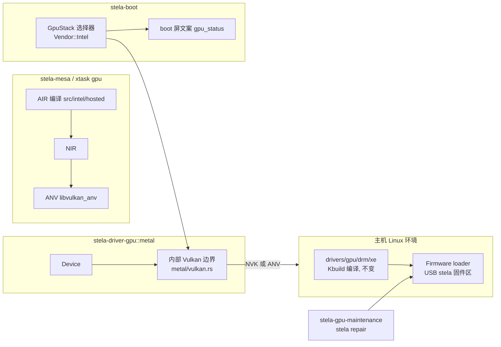

# Intel Xe-LPG GPU 全链路设计

Feature Name: intel-xe-gpu
Updated: 2026-11-16

## Description

把 Intel Xe（Xe-LPG：TGL/ADL/RLC 第 11–13 代 iGPU）作为 Stela 的第二
GPU 厂商补全到与 NVIDIA 等价的全链路：内核 xe 驱动 + Mesa ANV（Vulkan）
+ Metal 设备 + boot 引导与固件维护。目标硬件限定 Xe-LPG 集成显卡；
Arc dGPU（Xe-HPG/Xe-2/Xe-3）不在范围内。固件（GuC/HuC/DMC）走 USB +
`stela repair` 流程，与 NVIDIA GSP 一致。

## 现状盘点（决定本设计切片的依据）

| 组件 | 现状 | 结论 |
|---|---|---|
| `Adapter::discover` / `unavailable_reason` | Intel 已识别 | 改文案与探测门控即可 |
| `src/intel/hosted`（AIR 编译器、dispatch 打包器、sampler/surface/image） | 已存在，meson 已接 `stela_intel_*` 目标 | 直接复用，不重写 |
| `autoconf.h` | 已有 `CONFIG_DRM_XE_*` 参数值，无 `CONFIG_DRM_XE` 本体 | 需定义本体与依赖 |
| `third_party/linux.sparse` | 无 `drivers/gpu/drm/xe/` | 需增补 |
| `third_party/libdrm.sparse` | 只有 `include/drm/` + `amdgpu/*.h` | 需增补 `xe_drm.h`（ANV 需要） |
| NOTICE `src/intel/wopcm/storage/` | GuC 固件 backing 参考条目已预留，目录不存在 | 按条目建目录 |
| `build/nouveau.rs` 模式 | Kbuild 子集 + initcall 捕获 + OPEN 清单 | 直接照搬 |

## Architecture

要点：

- **xe 与 nouveau 并列，不共享驱动层**：xe 驱动自带 DRM 核心依赖
  （`drm_exec`、`drm_gpuvm`、`drm_sched`、ttm 均已在 `DRM_SOURCES`
  中）；xe 额外需要的内核服务在 OPEN 清单里逐符号列出。
- **Vulkan 边界不变**：`metal/vulkan.rs` 已声明完整边界；新增的是
  `NativeBackend` 下并行的 ANV 路径（NVK 路径保留），由 `GpuStack`
  的 vendor 选择。
- **固件**：xe 通过 `CONFIG_FW_LOADER` 取固件；Stela 的固件加载器
  从 USB `stela` 区按 catalogue `PciFirmware` 租约供给，缺失即
  `MissingFirmware`（boot 屏 → `stela repair`）。

## Components and Interfaces

### 1. `third_party` 与 sparse 清单

- `linux.sparse` 增补：
  - `/drivers/gpu/drm/xe/`（整个 xe 树：xe_guc、xe_hwengine、xe_bo、
    xe_dma_buf、xe_display、gu_c.h 等）
  - xe 依赖的 `/drivers/gpu/drm/i915/display/` 中 xe 引用部分（xe
    display 复用 `intel_display` 头与部分 helper）——按 xe 实际
    `#include` 收敛，不整目录搬。
  - `/drivers/gpu/drm/drm_*` 已齐（`DRM_SOURCES` 列表核对）。
- `libdrm.sparse` 增补：`/amdgpu/*.h` 行旁加 `# xe_drm.h`：
  `xe_drm.h`（ANV 的 `i915/drm_i915.h` 之外还需 `xe_drm.h` UAPI）。
- NOTICE 建 `crates/stela-driver-gpu/src/intel/wopcm/storage/`：
  GuC 固件 backing 参考目录（与 NOTICE 预留条目对齐，内容只放
  参考/占位说明，不放固件二进制）。

### 2. `stela-linux`（内核环境）

- `autoconf.h` 增加 `#define CONFIG_DRM_XE 1` 及其依赖
  （`CONFIG_DRM_I915` 若 xe 编译需要；按 Kbuild 解析结果定）。
  现有 `CONFIG_DRM_XE_*` 参数值（JOBS/TIMESLICE/PREEMPT 等）已就位。
- 新建 `build/xe.rs`（仿 `build/nouveau.rs`）：
  - `Kbuild::read(third_party/linux/drivers/gpu/drm/xe, config)` 走
    现有 Kbuild 子集解析器；xe 的 Kbuild 若出现子集外语句
    （如 `ccflags-y += -Wno-...`），在 `kbuild.rs` 内最小扩展并
    记录在规格评审中。
  - initcall 单元：`drivers/gpu/drm/xe/xe_drm`（`module_init` 点），
    `UnitSpec` 挂 gpu slice、新 group `xe`（ordinal 顺延，
    与 `COMMON`/`DRM_UNITS` 不冲突）。
  - `OPEN` 清单：xe 实际引用而环境缺失的符号（预计：
    `device_link_*`、`acpi_*` 若干、`i915` 遗留的
    `intel_uc_fw` 路径、display 的 `intel_fb_*`/`intel_vblanks` 等）；
    构建失败即暴露，与 nouveau 纪律相同。
  - `check_imports` 复用：新 archive `libstela-intel-xe.a` 对
    `linux.archive + common_archive` 的缺口必须与 `OPEN_XE` 完全相等。
- Kbuild 解析若需要 `#include <linux/intel/...>` 类路径，
  `drm_includes` 增加 `drm/i915/display` 与 `drm/xe` 的 include。

### 3. `stela-driver-gpu`

- 新 feature `xe-port`（依赖 `linux-kernel`，与 `nouveau-port`
  并列；不互相依赖）；`stela-drivers` 透传。
- `build.rs` 在 `xe-port` 下编译 `build/xe.rs::port(&mut linux)`，
  产物 `libstela-intel-xe.a`；uefi 目标链接之。
- `src/lib.rs`：
  - `Vendor::Intel` 的 `unavailable_reason` 改为按 device 判定：
    Xe-LPG 表内 → 空（可用）；表外 → "Intel GPU 仅支持
    Xe-LPG（11–13 代 iGPU）"。
  - 新增 Xe-LPG device 表（TGL: 0x9579/0x9A49/0x4906/0x4908/0x490A/
    0x490C/0x490D/0x490E/0x4910/0x4912/0x4913/0x4915/0x4916/0x4917/
    0x4919/0x4924/0x4926；ADL: 0x467x 系 0x468x 系；RLC: 0x7D4x/
    0x7DEx 等），放 `src/intel/devices.rs`，测试覆盖。
- `stack.rs`：`GpuStack::select` 的 `Vendor::Intel` 分支在 `xe-port`
  feature 下返回 xe 栈（`Kernel` 指向 xe 驱动的 initcall image），
  非 Xe-LPG device 维持拒绝。

### 4. Mesa / xtask

- `xtask/src/gpu/nvk.rs`：`OPTIONS` 的 `-Dvulkan-drivers=nouveau` 改为
  `-Dvulkan-drivers=nouveau,intel`；`DRIVERS` 增补
  `src/intel/vulkan/libvulkan_anv.so`；归档增
  `libstela-anv.a`（`stela-mesa` build.rs 的链接清单同步）。
- `src/compiler/meson.build`：已有 `stela_intel_*` 目标，ANV 需要的
  `intel_vulkan` 依赖面按 meson 输出核对（`libisl`、`genxml` 已含）。
- `metal/open.rs`：`NativeBackend` 在 Intel device 走 ANV 入口；
  边界（`vulkan.rs`）零改动。

### 5. Boot 与维护

- `stela-boot/src/engine/gpu/`：xe 栈的 probe/固件/启动路径，
  复用 `gpu_requests.rs` 的 `HostCall`/`Request` 与
  `gpu_status.rs` 的 `Reason`；`firmware_requests` 的
  `fixable` 语义扩展到 GuC 缺失。
- `gpu_status.rs`：
  - 新增 `xe_firmware(device, family) -> &'static str`（TGL/ADL/RLC
    家族名）；`unused` 文案按 R4。
  - `GspStart` 式失败行解析新增 `XguStart`（读 xe 的
    `xe_guc` 日志行：`gu: BOOT...`、`guc: ...` 失败码），
    `driver_stopped` 复用。
- `stela-gpu-maintenance`：`repair` 增加 Xe-LPG 家族固件清单
  （`intel/guc_12_*.bin`、`intel/huc_*.bin`、
  `intel/dmc_g12/g20_*.bin` 对应家族），写 USB 前校验 SHA 与
  版本匹配（对齐 `FirmwareTarget` 校验语法）。

## Data Models

- **Xe-LPG device 表**：`(&'static str 家族, u16 device)` 三元组，
  放 `stela-driver-gpu::intel::devices`；boot 文案与维护清单共享。
- **OPEN_XE 清单**：`&[(&str, &[&str])]`（服务名 → 符号），
  与 nouveau `OPEN` 同形，供 `check_imports` 校验。
- **固件家族名**：`enum XeFirmwareFamily { Tgl, Adl, Rlc }`，
  GuC/HuC/DMC 三类的 `FirmwareTarget` 名称由它派生，保证 catalogue
  校验与 xe 驱动请求的 `firmware name` 一致。

## Correctness Properties

- xe 驱动源码不改动（Kbuild 子集解析拒绝子集外语法 → 漂移即构建
  失败）。
- `check_imports`：`libstela-intel-xe.a` 的未满足导入必须等于
  `OPEN_XE` 集合；多一个少一个都失败。
- 非 Xe-LPG Intel device 的 probe 必须在 `xe_drm` 的 platform
  门控点拒绝（xe 自己的 `Xe-LPG` 判定），Stela 不另立第二套表；
  device 表只用于 boot 文案与维护清单。
- 固件版本与 device 的匹配检查发生在 catalogue 租约授予前；
  GuC 失败码解析只读日志，不改驱动行为。

## Error Handling

| 场景 | 行为 |
|---|---|
| GuC/HuC/DMC 缺失 | boot 屏 `MissingFirmware` 文案 + `stela repair` 指引（同 GSP） |
| GuC boot 失败 | `XguStart` 解析日志行，`driver_stopped` 文案 |
| 非 Xe-LPG Intel device | probe 拒绝；boot 屏 "unused: 仅支持 Xe-LPG" |
| xe Kbuild 超子集 | 构建失败并指明文件行 |
| OPEN 符号漂移 | `check_imports` 构建失败，列出新增/消失符号 |
| ANV/xe 链接缺失 | `stela-mesa` build.rs 的既有缺档断言（先 `xtask gpu`） |

## Test Strategy

1. **hosted C 测试**（`src/compat/linux/stela/`）：
   - `xe_bo_test.c`：页表分配/`xe_bo` 状态机（对齐 `drm_mm_test`
     的位置与纪律）。
   - `xe_sched_test.c`：fence 信号/`xe_sched` 行为。
   挂到 `stela-driver-gpu::tests`（仿 `linux_drm_mm` 注册）。
2. **meson 测试**：`src/intel/tests/` 全部（AIR、渲染、dispatch、
   surface/sampler/image/legacy）在 `stela` suite 通过；ANV 新目标
   纳入 `xtask gpu` 的探针记录（`record.rs` 机制）。
3. **Rust 单测**：
   - `intel::devices` 表与 `unavailable_reason`（仿
   `lib.rs::tests` 的 `ReadOnlyConfig` 风格，不触硬件）。
   - `stack.rs` 的 vendor 选择（xe-port on/off 两态）。
   - `gpu_status.rs` 新文案（仿现有测试，逐字符串断言）。
4. **维护**：`stela-gpu-maintenance` 的固件清单校验用
   `tempfile` 临时 USB 模拟（该 crate 已有 `tempfile` dev-dep）。
5. **构建门禁**：`cargo xtask gpu fetch` 后 `cargo build
   --features xe-port` 在 CI 通过 `check_imports` 与 meson
   测试全套。

## References

[^1]: (File) - nouveau 端口模式: `crates/stela-driver-gpu/build/nouveau.rs`
[^2]: (File) - Kbuild 子集解析器: `crates/stela-driver-gpu/build/kbuild.rs`
[^3]: (File) - 共享 DRM 源码/单元: `crates/stela-driver-gpu/build/native.rs`
[^4]: (File) - 内部 Vulkan 边界: `crates/stela-driver-gpu/src/metal/vulkan.rs`
[^5]: (File) - Metal 设备打开路径: `crates/stela-driver-gpu/src/metal/open.rs`
[^6]: (File) - boot GPU 引擎: `crates/stela-boot/src/engine/gpu.rs`
[^7]: (File) - boot 屏文案: `crates/stela-boot-core/src/gpu_status.rs`
[^8]: (File) - 请求码: `crates/stela-boot-core/src/gpu_requests.rs`
[^9]: (File) - NVK 构建: `xtask/src/gpu/nvk.rs`
[^10]: (File) - Intel 编译器 meson: `crates/stela-driver-gpu/src/compiler/meson.build`
[^11]: (File) - GuC 固件 backing 条目: `NOTICE` L380
[^12]: (File) - Kconfig 参数值: `crates/stela-linux/src/compat/generated/autoconf.h` L74-90
